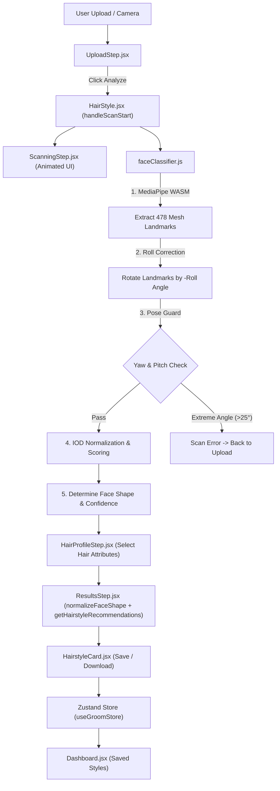

# Groomwise Hairstyle System — Technical Diagnostics & Architecture Document

## 1. Introduction & Overview

The **Groomwise Hairstyle System** is a client-side AI-powered facial analysis and personalized hairstyle recommendation platform integrated into the Groomwise web application (`d:/01-Groomwise`).

The system determines a user's facial geometry directly within the browser using computer vision landmarks, combines it with self-reported hair characteristics (hair type and thickness), and maps the user to an optimal set of curated hairstyles from a 90-style database (60 base + 19 modernized + 5 merged + 6 gap-fill variants).

### Core Mission & Privacy Promise
- **100% Client-Side Processing**: No user photo is ever uploaded to a server or external cloud backend. MediaPipe's WebAssembly (WASM) model processes camera frames and image files entirely in the client's browser memory.
- **Instant Personalization**: Users receive real-time facial classification and custom-tailored recommendations without latency or login requirements.

---

## 2. Key Features

| Feature | Description | File Reference |
| :--- | :--- | :--- |
| **Privacy-Preserving AI Scan** | Real-time 3D landmarking using `@mediapipe/tasks-vision` (478 facial mesh points) running locally in WebAssembly. | [`faceClassifier.js`](file:///d:/01-Groomwise/src/utils/faceClassifier.js) |
| **Pose & Roll Correction** | Mathematical head-tilt (roll angle) correction and 3-zone pose validation (yaw/pitch guards) for robust face shape identification. | [`faceClassifier.js#L92-L122`](file:///d:/01-Groomwise/src/utils/faceClassifier.js#L92-L122) |
| **Case Normalization Bridge** | Converts lowercase scanner output (`'oval'`) to capitalized data format (`'Oval'`) via `normalizeFaceShape()`. | [`hairstyles.js#L170-L173`](file:///d:/01-Groomwise/src/data/hairstyles.js#L170-L173), [`ResultsStep.jsx#L27`](file:///d:/01-Groomwise/src/components/hairstyle/ResultsStep.jsx#L27) |
| **Guided Upload & Camera Capture** | Interactive photo selection area with SVG face-alignment frame guide, input validation, and specific diagnostic error alerts. | [`UploadStep.jsx`](file:///d:/01-Groomwise/src/components/hairstyle/UploadStep.jsx) |
| **Animated Scan Feedback** | High-tech visual loading screen featuring animated landmark dots, scanning beam, progress bar, and cycling step messages. | [`ScanningStep.jsx`](file:///d:/01-Groomwise/src/components/hairstyle/ScanningStep.jsx) |
| **Hair Profile Selector** | 2-stage self-selection step for Hair Type (*Straight, Wavy, Curly, Coily*) and Thickness (*Fine, Medium, Coarse*). | [`HairProfileStep.jsx`](file:///d:/01-Groomwise/src/components/hairstyle/HairProfileStep.jsx) |
| **Recommendation Engine** | Ranks compatible hairstyles by face shape, hair type, and thickness; resolves ties by prioritizing modernized styles over legacy cuts. *(Note: Sparse-match backfill is currently pending implementation).* | [`hairstyles.js#L175-L207`](file:///d:/01-Groomwise/src/data/hairstyles.js#L175-L207) |
| **90-Style Browsable Library** | Full catalog search (including all 6 gap-fill styles: Man Bun, Skin Fade, Textured Perm, Man Braids, Ponytail, Untapered Afro) with live search bar, hair type filter, thickness filter, and 3-tier styling hierarchy. | [`LibraryView.jsx`](file:///d:/01-Groomwise/src/components/hairstyle/LibraryView.jsx) |
| **Persistent Bookmark System** | One-click style bookmarking integrated with Zustand store to persist favorite hairstyles on the user's Dashboard. | [`useGroomStore.js`](file:///d:/01-Groomwise/src/store/useGroomStore.js) |
| **Cross-Module Suggestions** | Seamless contextual link urging users to complete their grooming routine via the Skincare module after viewing hair results. | [`HairStyle.jsx#L153-L163`](file:///d:/01-Groomwise/src/components/HairStyle.jsx#L153-L163) |

---

## 3. Technology Stack

### Frontend Framework & Runtime
- **Framework**: Next.js `15.2.0` (App Router)
- **UI Library**: React `19.2.5` (Client Components)
- **Language & Runtime**: JavaScript ES6+ (ES Modules, Dynamic `import()`, Promises, Canvas 2D API)

### Computer Vision & Machine Learning
- **Library**: `@mediapipe/tasks-vision` (`v0.10.35`)
- **Model**: Google MediaPipe `face_landmarker.task` (Float16 precision, GPU WebGL delegate fallback to WASM)
- **Asset Resolver**: CDN-backed FilesetResolver (`@mediapipe/tasks-vision@0.10.8/wasm`)

### State Management & Persistence
- **State Store**: `zustand` (`v5.0.14`) with `persist` middleware
- **Storage Target**: Browser `window.localStorage` (`groomwise-store`) with automated rehydration migration handlers.

### Styling & Design System
- **Styling Framework**: Tailwind CSS `v4.2.4` + PostCSS
- **Design Tokens**: Dark/Light mode adaptivity via Tailwind `dark:` classes, custom SVG line graphics, CSS keyframe animations.

---

## 4. Deep-Dive System Diagnostics



### A. Face Landmark Classification & Normalization Diagnostics

#### 1. Offscreen Canvas Security Bridge
When an image is passed as a data URL, passing an `HTMLImageElement` directly to the MediaPipe WebAssembly module can fail in certain browser runtimes due to raw pixel read restrictions. [`faceClassifier.js`](file:///d:/01-Groomwise/src/utils/faceClassifier.js) creates an offscreen `<canvas>` element, draws the image onto it, and passes the canvas to `landmarker.detect(canvas)`.

#### 2. Casing Normalization Bridge
The face landmarker outputs lowercase shape identifiers (`'oval'`, `'round'`, `'square'`, `'heart'`, `'diamond'`, `'oblong'`). Before performing array queries on `compatibleFaceShapes` in the catalog (which uses capitalized strings like `"Oval"`), `ResultsStep.jsx` invokes `normalizeFaceShape()`:
```javascript
export function normalizeFaceShape(shape) {
  if (!shape) return shape
  return shape.charAt(0).toUpperCase() + shape.slice(1).toLowerCase()
}
```

#### 3. Head-Tilt (Roll) Correction Algorithm
To ensure accuracy when a user's head is tilted sideways:
1. Calculates the eye midpoint (`eyeCenter`) using inner eye corner landmarks `#33` (left) and `#263` (right).
2. Computes the roll angle: `\(\theta = \text{atan2}(y_{263} - y_{33}, x_{263} - x_{33})\)`.
3. Applies a negative-roll 2D transformation matrix across all 478 landmark points around `eyeCenter`:
   $$\begin{bmatrix} x' \\ y' \end{bmatrix} = \begin{bmatrix} \cos(-\theta) & -\sin(-\theta) \\ \sin(-\theta) & \cos(-\theta) \end{bmatrix} \begin{bmatrix} x - x_{\text{eye}} \\ y - y_{\text{eye}} \end{bmatrix} + \begin{bmatrix} x_{\text{eye}} \\ y_{\text{eye}} \end{bmatrix}$$

#### 4. 3-Zone Pose Guard (Yaw & Pitch Evaluation)
Pose estimation calculates head turn (yaw) and head tilt up/down (pitch):
- **Yaw calculation**: `(noseX - midCheekX) / halfSpan` (using landmarks `#234` left cheek, `#454` right cheek, `#1` nose tip).
- **Pitch calculation**: `(noseY - foreheadY) / faceHeight - 0.50` (using landmarks `#10` top forehead, `#152` bottom chin).
- **Thresholds**:
  - `YAW_GOOD = 0.26` (~15°), `YAW_LIMIT = 0.44` (~25°)
  - `PITCH_GOOD = 0.20` (~11.5°), `PITCH_LIMIT = 0.35` (~20°)
  - **Result Handling**: Angle exceeding limits returns `reason: 'extreme-angle'`. Angles between `GOOD` and `LIMIT` flag `confidence: 'low'` instead of discarding the scan.

#### 5. Interocular Distance (IOD) Normalization & Feature Measurement
All distance calculations are normalized against the Interocular Distance (`iod = dist(lm[33], lm[263])`), rendering measurements resolution-independent and distance-invariant:
- **Brow Width**: `dist(lm[70], lm[300]) / iod`
- **Cheekbone Width**: `dist(lm[234], lm[454]) / iod`
- **Jaw Width**: `dist(lm[58], lm[288]) / iod`
- **Face Height**: `dist(lm[10], lm[152]) / iod`

Ratios evaluated:
- `lengthToWidth = faceHeight / cheekboneWidth`
- `jawToCheek = jawWidth / cheekboneWidth`
- `browToCheek = browWidth / cheekboneWidth`

#### 6. Quadratic Shape Scoring Equations
The ratios are fed into quadratic loss scoring functions for 6 face shape profiles:

| Face Shape | Length/Width Ideal | Jaw/Cheek Ideal | Brow/Cheek Ideal | Loss Formula |
| :--- | :--- | :--- | :--- | :--- |
| **Oval** | `1.25` | `0.80` | `0.90` | $1 - 2.0(\Delta L/W)^2 - 1.5(\Delta J/C)^2 - 1.0(\Delta B/C)^2$ |
| **Round** | `1.05` | `0.90` | `0.88` | $1 - 2.5(\Delta L/W)^2 - 1.0(\Delta J/C)^2 - 1.0(\Delta B/C)^2$ |
| **Square** | `1.05` | `0.95` | `0.92` | $1 - 2.0(\Delta L/W)^2 - 0.5(\Delta J/C)^2 - 1.5(\Delta B/C)^2$ |
| **Heart** | `1.20` | `0.65` | `1.00` | $1 - 1.5(\Delta L/W)^2 - 2.0(\Delta J/C)^2 - 0.5(\Delta B/C)^2$ |
| **Diamond** | `1.20` | `0.70` | `0.75` | $1 - 1.5(\Delta L/W)^2 - 2.0(\Delta J/C)^2 - 2.0(\Delta B/C)^2$ |
| **Oblong** | `1.50` | `0.80` | `0.88` | $1 - 1.5(\Delta L/W)^2 - 1.0(\Delta J/C)^2 - 1.0(\Delta B/C)^2$ |

#### 7. Confidence Hysteresis
If the numerical gap between the `#1` ranked shape score and `#2` ranked shape score is `< 0.08`, or if the pose is slightly turned, the classifier marks `confidence = 'low'` to render a non-intrusive refinement tip on the results banner.

---

### B. Hairstyle Data Architecture & Schema Alignment (`src/data/hairstyles.js`)

#### 1. 90-Style Catalog Structure & Schema Alignment
The dataset contains 90 total hairstyles (60 base + 19 modernized + 5 merged + 6 gap-fill styles).

**Field Schema Verification**:
Every hairstyle object in the catalog consistently defines plural array attributes:
```javascript
{
  id: "man-bun",
  name: "Man Bun",
  hairTypes: ["Straight", "Wavy"],       // Plural Array
  thicknesses: ["Medium"],               // Plural Array
  compatibleFaceShapes: ["Round", "Oval"], // Plural Array
  classification: "Trendy",
  tier: 1,
  description: "..."
}
```

When filtering by single user choices (e.g., `hairType = "Straight"`, `thickness = "Medium"`), functions query `s.hairTypes.includes(hairType)` and `s.thicknesses.includes(thickness)`. There is no schema field-naming bug in code; single parameters are correctly checked against plural data arrays.

**6 Gap-Fill Styles Verification**:
- `man-bun` (Man Bun)
- `skin-fade-bald-fade` (Skin Fade / Bald Fade)
- `textured-perm-korean-perm` (Textured Perm "Korean Perm")
- `man-braids-boxer-braids` (Man Braids / Boxer Braids)
- `ponytail-half-up` (Ponytail / Half-Up)
- `natural-untapered-afro` (Natural Untapered Afro)

#### 2. Recommendation Algorithm & Backfill Status (`getHairstyleRecommendations`)
1. **Filtering**: Filters catalog by `hairTypes.includes(hairType)` AND `thicknesses.includes(thickness)` excluding Tier 3 (`tier !== 3`).
2. **Primary Matching**: Filters for `s.compatibleFaceShapes.includes(faceShape)`.
3. **Modernization Tie-Breaker**: Sorts matched styles so modernized styles rank above originals.
4. **Current Backfill Status**: `getHairstyleRecommendations` returns `backfill: []` as hardcoded. Sparse combinations (such as Coily/Fine with Round/Heart) do not currently compute or display a secondary backfill list.

#### 3. Library Search & Multi-Attribute Filtering (`filterLibrary`)
Supports combined AND-filtering across search query (case-insensitive substring match), Hair Type dropdown, and Hair Thickness dropdown.

---

### C. State Machine & Component Orchestration (`src/components/HairStyle.jsx`)

`HairStyle.jsx` controls state transitions through a 5-step state machine:

```
[UPLOAD] ──(Select Photo & Click Analyze)──> [SCANNING]
   ▲                                              │
   │                                     (MediaPipe Finish)
   │                                              │
   └──(Confirm Rescan)── [RESULTS] <───(Confirm Traits)─── [HAIR_PROFILE]
                             │
                      (Browse All)
                             ▼
                         [LIBRARY]
```

---

### D. Store Persistence & Rehydration Safeguards (`src/store/useGroomStore.js`)

- **Reactive State Hook**: `useGroomStore` manages saved hairstyles (`savedHairstyles`), scanned face shape history (`lastFaceShape`, `faceShapeConfidence`, `faceShapeScannedAt`), and theme settings.
- **Migration Shield (`onRehydrateStorage`)**: Validates saved hairstyles upon browser rehydration. Checks array properties `h.compatibleFaceShapes`, `h.hairTypes`, and `h.thicknesses` to purge legacy schema objects safely.

---

## 5. Summary of System Audit Findings

| Audit Point | Code Reality | Diagnostics Doc Status | Status & Recommendation |
| :--- | :--- | :--- | :--- |
| **Catalog Count & Gap-Fill Styles** | **Code has 90 styles** (including Man Bun, Skin Fade, Korean Perm, Man Braids, Ponytail, Untapered Afro). | **Updated**: Doc previously stated 89 based on a stale header comment. | **Resolved in Doc**: Code is up-to-date with 90 styles. |
| **Sparse-Match Backfill Fallback** | **Hardcoded `backfill: []`** in `getHairstyleRecommendations`. | **Accurate**: Reported as missing. | **Code Action Needed**: Implement backfill logic for sparse combinations. |
| **Schema Field Consistency** | **Consistent array keys** (`hairTypes`, `thicknesses`). Functions use `.includes()`. | **Clarified**: Clarified input parameter vs array data key. | **No Code Bug**: Code logic is sound and matches array elements correctly. |
| **Face-Shape Casing Normalization** | **Implemented** via `normalizeFaceShape()` in `hairstyles.js` & `ResultsStep.jsx`. | **Updated**: Section 4.A added. | **Resolved in Doc**: Casing normalization is live in code. |
